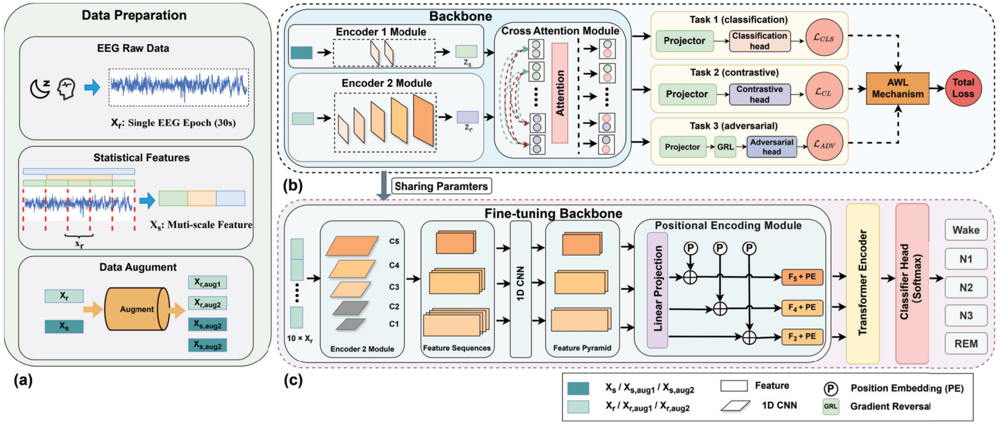

# K-SleepNet

**K-SleepNet: Knowledge-Enhanced Single-Channel Sleep Staging via Dual-Stream Multi-Task Learning**

[](https://doi.org/10.1109/CSCWD68734.2026.11581617) [](LICENSE)

> 📄 Published in *Proceedings of the 2026 29th International Conference on
> Computer Supported Cooperative Work in Design (CSCWD)* —
> DOI: [10.1109/CSCWD68734.2026.11581617](https://doi.org/10.1109/CSCWD68734.2026.11581617).
>
> This repository is the **architecture-level reference implementation** of the paper.

## Overview

K-SleepNet performs single-channel EEG sleep staging with a dual-stream,
knowledge-enhanced design:

- **Dual-stream encoding** — a DeepSleepNet-style two-branch CNN encodes the raw
  30-s epoch, while an MLP encodes a **153-dim multi-scale statistical feature
  vector** (time / frequency / energy / nonlinear-entropy / peak features over
  {1, 3, 5}-epoch windows; paper Table I);
- **Cross-attention fusion** — the raw embedding (query) attends to the
  statistical knowledge embedding (key/value);
- **Multi-task pretraining (Phase 1)** — joint supervision with sleep-stage
  classification (CE), supervised contrastive learning (SupCon), and a
  domain-adversarial discriminator through a gradient reversal layer, combined
  under an **uncertainty-based adaptive loss weighting** (AWL, Eq. 4);
- **Sequence fine-tuning (Phase 2)** — a multi-scale pyramid ({1,2,4} centered
  max-pooling) plus a Transformer encoder over 10-epoch sequences, classifying
  the center epoch.

<div align="center">
  
  <p><em>Overall architecture of K-SleepNet (Fig. 1 of the paper).</em></p>
</div>


## Repository Contents

```
src/ksleepnet/
├── models/
│   ├── encoders.py     # RawEncoder (two-branch CNN) + StatEncoder (153-dim MLP)
│   ├── fusion.py       # Cross-attention fusion (Q=raw, K/V=stat)
│   ├── grl.py          # Gradient reversal layer
│   ├── ksleepnet.py    # KSleepNetPretrain + KSleepNetFinetune + MultiScalePyramid
│   └── losses.py       # SupCon loss + CE (hard/soft labels)
├── train/
│   └── awl.py          # Automatic Weighted Loss (Eq. 4, learnable task weights)
└── data/
    └── features.py     # 153-dim multi-scale statistical features (paper Table I)
```


## Citation

If you find this work useful, please cite:

```bibtex
@inproceedings{yu2026ksleepnet,
  title     = {K-SleepNet: Knowledge-Enhanced Single-Channel Sleep Staging
               via Dual-Stream Multi-Task Learning},
  author    = {Yu, Qiuchen and Li, Ziyi and Wang, Qisong and Liu, Xinxin and
               Lei, Xiaochen and Zhang, Xurui and Gao, Guosong and Hou, Zhongjie and
               Bai, Hua and Li, Jiayue and Chen, Xiaohe},
  booktitle = {2026 29th International Conference on Computer Supported
               Cooperative Work in Design (CSCWD)},
  year      = {2026},
  pages     = {3646--3651},
  doi       = {10.1109/CSCWD68734.2026.11581617}
}
```

